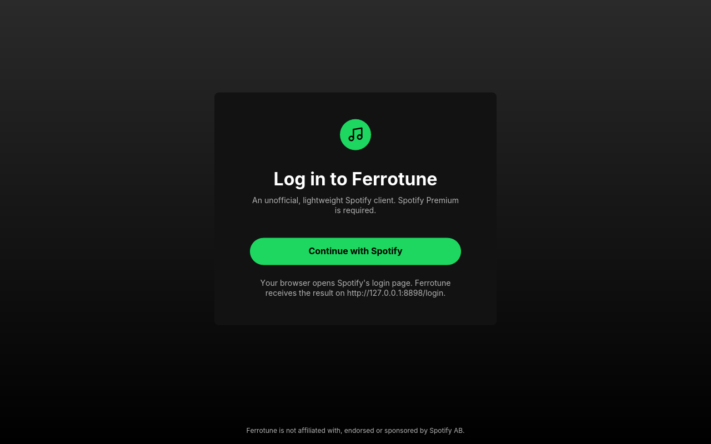
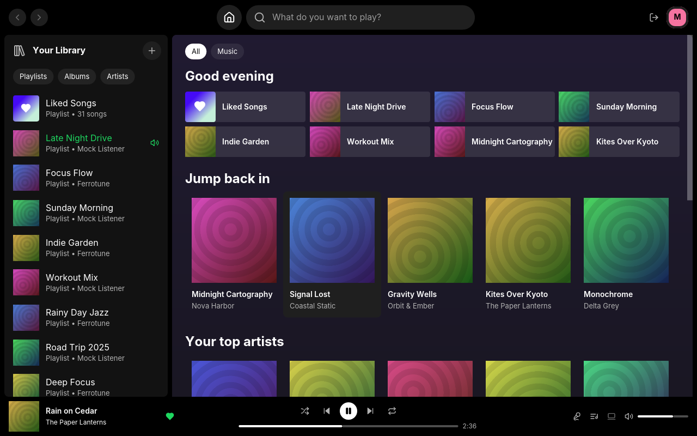
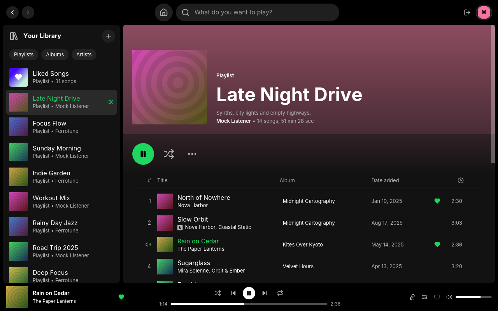
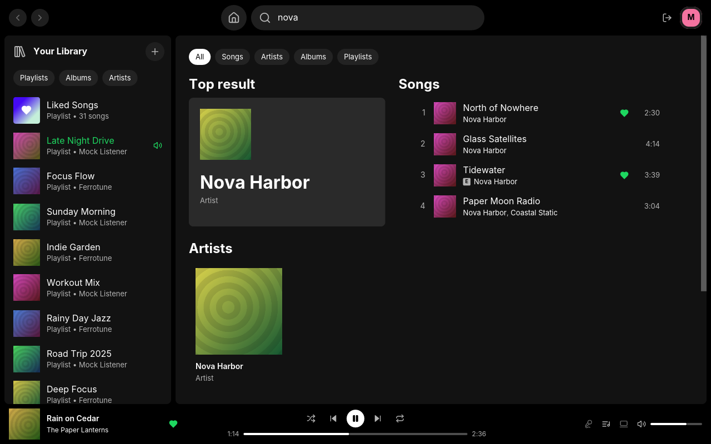
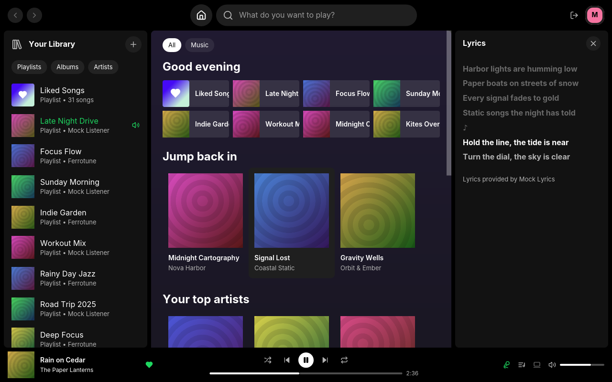
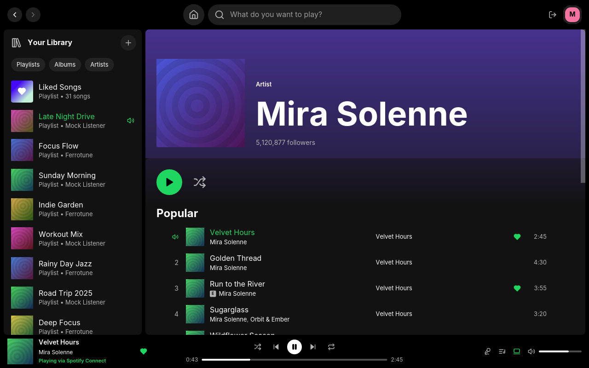

# Ferrotune

Lightweight native Spotify desktop client written in Rust, with an
[iced](https://iced.rs) UI that follows the look of the official desktop app
(dark theme, "Your Library" sidebar, gradient headers, track tables, bottom
now-playing bar).

> **Unofficial client — use at your own risk.** Ferrotune is not affiliated
> with, endorsed or sponsored by Spotify AB. It talks to Spotify the way the
> official desktop app does, but Spotify has not approved it.
>
> - Third-party clients may violate the
>   [Spotify Terms of Use](https://www.spotify.com/legal/end-user-agreement/).
> - **Your account can be restricted or banned**, as with any third-party
>   client. Do not use an account you cannot afford to lose.
> - Spotify can change its internal APIs at any time, and parts of Ferrotune
>   (or all of it) can stop working without warning.
>
> Ferrotune ships no Spotify logos, icons or fonts; the UI uses
> [Inter](https://rsms.me/inter/) (SIL OFL 1.1), [Lucide](https://lucide.dev)
> icons (ISC) and its own icon. "Spotify" is a trademark of Spotify AB.

**Spotify Premium is required.** Audio is streamed with
[librespot](https://github.com/librespot-org/librespot), which only works for
Premium accounts.

## Features

- Zero-configuration login: click **Log in**, approve in the browser, done.
  Later starts log in silently from the OS keyring.
- Home (Spotify's own shelves), Search (tracks, artists, albums, playlists),
  Your Library (playlists, albums, artists, Liked Songs), Playlist / Album /
  Artist views, Queue panel, synced lyrics.
- Playback with queue, seek, volume, shuffle and repeat (off / context /
  track), album art with a bounded LRU cache.
- **Spotify Connect:** Ferrotune shows up as "Ferrotune on &lt;hostname&gt;"
  in the phone app and other Spotify clients, which can cast to it and
  control it.
- **Keyboard shortcuts** like the desktop client (press `Ctrl+/` or `?` for
  the list): Space play/pause, Ctrl+Left/Right previous/next, Ctrl+Up/Down
  volume, Ctrl+L or Ctrl+K search, Ctrl+S shuffle, Ctrl+R repeat,
  Alt+Left/Right back/forward, Ctrl+Q quit.
- **Context menus** (right click) on tracks, albums, artists and playlists:
  add to queue, go to artist/album, like, add to playlist, remove from this
  playlist, copy link.
- **Playlist editing:** create (the + in Your Library), rename, delete, add,
  remove and drag to reorder tracks in your own playlists. Changes show at
  once and are undone if Spotify refuses them.
- Gapless playback: the next track is preloaded before the current one ends.
- MPRIS (`org.mpris.MediaPlayer2` + `.Player`) on Linux, so KDE media keys and
  the Plasma media widget work.
- SQLite cache: the first frame is drawn from cached data without network,
  and Spotify responses are cached so screens are not re-fetched constantly.

## How login works

1. Click **Log in**. Your browser opens `accounts.spotify.com`. Log in and
   approve. The page redirects to `http://127.0.0.1:8898/login`, where
   Ferrotune is listening, and you are done. Nothing needs registering or
   configuring.
2. Ferrotune uses that one-off token to open a
   [librespot](https://github.com/librespot-org/librespot) session, then keeps
   only librespot's reusable credentials, in the OS keyring (Secret Service:
   KWallet / GNOME Keyring). Nothing secret is written to disk or to logs.
3. On the next start the session opens silently from the keyring. Only if
   Spotify answers "bad credentials" (for example after a password change)
   are they deleted, and the next click opens the browser again. Temporary
   errors keep them.
4. If no keyring is available, Ferrotune shows how to enable KDE Wallet or
   GNOME Keyring, with a **Try again** button. It never falls back to a file.
5. If port 8898 is already in use, the login screen says so. Close the other
   program or set `FERROTUNE_REDIRECT_PORT`. Other ports have not been verified
   to work with the desktop client id; 8898 is the one librespot documents.

Behind the scenes:

- Ferrotune uses the **same public desktop client id that librespot uses**,
  as other open-source clients such as
  [ncspot](https://github.com/hrkfdn/ncspot) and
  [spotify-player](https://github.com/aome510/spotify-player) do. It is read
  from librespot itself, not copied into Ferrotune.
- Everything (audio, library, search, Home, lyrics, Spotify Connect) goes
  through that one session and the internal endpoints the desktop client
  uses. Ferrotune does not use the public Web API (`api.spotify.com`).
  [docs/protocol.md](docs/protocol.md) lists every endpoint.
- The `spotify-app-version`, `app-platform` and User-Agent values are the
  ones librespot itself announces (taken from `librespot_core::version`), not
  invented by Ferrotune.
- **Search and Home use GraphQL persisted-query hashes that ship as
  unverified defaults.** Nobody has checked them against the live service.
  When Spotify rejects them, Ferrotune falls back to older endpoints with
  less detail. [docs/protocol.md](docs/protocol.md) explains how to refresh
  them without rebuilding.
- **This is not an official integration.** Spotify can break it at any time,
  and it may violate Spotify's terms. Internal APIs have server-side limits
  too. Ferrotune caches responses, honours `Retry-After` and avoids request
  bursts, but nothing can guarantee that you will not be rate-limited or that
  your account will not be flagged.

## Build and run

Requirements: Rust stable (edition 2024), and on Linux the dev packages
`pkg-config libdbus-1-dev libasound2-dev libxkbcommon-dev libwayland-dev`.
A Secret Service provider (KWallet or GNOME Keyring) must be running.

```sh
cargo build --release
./target/release/ferrotune            # real client
./target/release/ferrotune --mock     # offline demo with fictional data
./target/release/ferrotune --screenshot home docs/screenshots/home.png
```

Screens for `--screenshot`:
`login home search library playlist album artist liked queue lyrics connect keyring`.

### Desktop entry and icon

So that KDE/GNOME show Ferrotune in the launcher with its icon, and group its
windows and media controls correctly, install the desktop entry:

```sh
ferrotune --install-desktop-entry
```

This writes `~/.local/share/applications/dev.ferro.ferrotune.desktop` (with
an absolute path to the binary) and
`~/.local/share/icons/hicolor/scalable/apps/dev.ferro.ferrotune.svg`. The
same files are in `assets/desktop/` if you prefer to copy them by hand.

### Optional settings

Nothing is required. `~/.config/ferrotune/config.json` may contain:

```json
{ "bitrate": "320", "theme": "dark", "connect": true }
```

| Setting | Env var | Default |
|---|---|---|
| Audio quality (`96`/`160`/`320`) | — | `160` |
| Spotify Connect device | `FERROTUNE_CONNECT=0` disables | on |
| Theme | `FERRO_THEME` (`dark`/`light`) | `dark` |
| Login redirect port | `FERROTUNE_REDIRECT_PORT` | `8898` |
| Startup timing | `FERRO_TRACE_STARTUP=1` | off |
| Log filter | `RUST_LOG` | `info` |
| Renderer | `ICED_BACKEND` (`tiny-skia`/`wgpu`) | `tiny-skia` (lowest memory) |

## Development

```sh
cargo fmt --check
cargo clippy --all-targets -- -D warnings
dbus-run-session -- cargo test     # the MPRIS test needs a session bus
```

Tests never use the network or a real account: the internal APIs are tested
against `wiremock` with protobuf/JSON fixtures. See
[docs/architecture.md](docs/architecture.md) and
[docs/protocol.md](docs/protocol.md).

## Screenshots (mock data)

| | |
|---|---|
|  |  |
|  |  |
|  |  |

## License

MIT (code and the Ferrotune icon). Bundled fonts: SIL OFL 1.1
(`assets/fonts/OFL.txt`). Icons: ISC (`assets/icons/LICENSE`).
