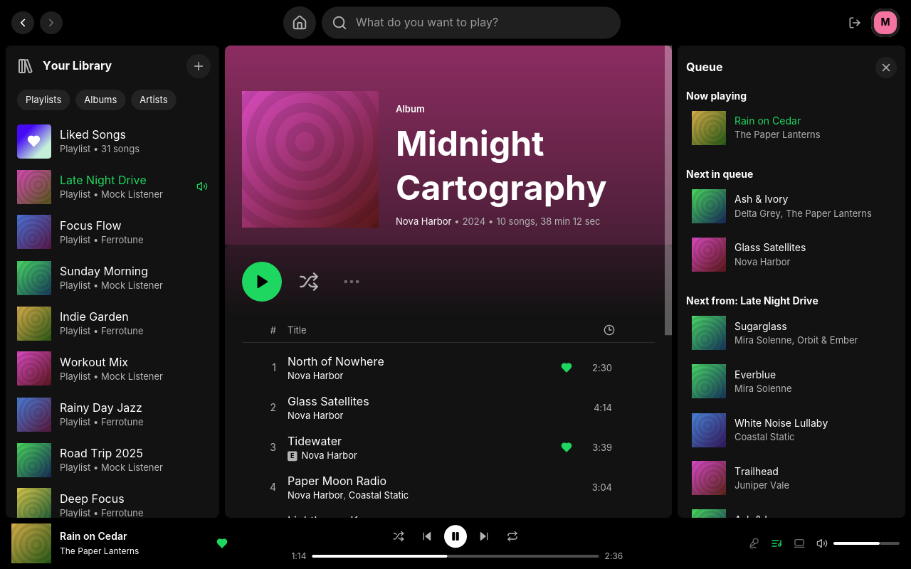

# Ferrotune

Lightweight native Spotify desktop client written in Rust, with an
[iced](https://iced.rs) UI that follows the look of the official desktop app
(dark theme, "Your Library" sidebar, gradient headers, track tables, bottom
now-playing bar).

> **Unofficial client.** Ferrotune is not affiliated with, endorsed or
> sponsored by Spotify AB. It ships no Spotify logos, icons or fonts; the UI
> uses [Inter](https://rsms.me/inter/) (SIL OFL 1.1) and
> [Lucide](https://lucide.dev) icons (ISC). "Spotify" is a trademark of
> Spotify AB. Use it at your own risk and within Spotify's terms.

**Spotify Premium is required.** Audio is streamed with
[librespot](https://github.com/librespot-org/librespot), which only works for
Premium accounts. Library, search and playlists use the Spotify Web API.

## Features

- OAuth login (Authorization Code + PKCE, loopback redirect). Tokens and the
  librespot credentials live only in the OS keyring.
- Home, Search (results by type), Your Library (playlists, albums, artists,
  Liked Songs), Playlist / Album / Artist views, Queue panel.
- Playback with queue, seek, volume, shuffle and repeat (off / context /
  track), album art with a bounded LRU cache.
- MPRIS (`org.mpris.MediaPlayer2` + `.Player`) on Linux, so KDE media keys and
  the Plasma media widget work.
- SQLite cache: the first frame is drawn from cached data without network.

## Register a Spotify app (required once)

Ferrotune does not embed a client id. Create your own:

1. Open <https://developer.spotify.com/dashboard> and **Create app**.
2. Select **Web API** and **Web Playback SDK**.
3. Add the redirect URI `http://127.0.0.1:8898/login` (Spotify requires the
   literal loopback IP, not `localhost`).
4. Copy the **Client ID** (no client secret is needed with PKCE).
5. In development mode, add your Spotify account under **User Management**.

Then either export it:

```sh
export FERROTUNE_CLIENT_ID=<your client id>
```

or put it in `~/.config/ferrotune/config.json`:

```json
{ "client_id": "<your client id>", "redirect_port": 8898, "bitrate": "320", "theme": "dark" }
```

| Setting | Env var | Default |
|---|---|---|
| Client id | `FERROTUNE_CLIENT_ID` | none (required) |
| Redirect port | `FERROTUNE_REDIRECT_PORT` | `8898` |
| Theme | `FERRO_THEME` (`dark`/`light`) | `dark` |
| Startup timing | `FERRO_TRACE_STARTUP=1` | off |
| Log filter | `RUST_LOG` | `info` |
| Renderer | `ICED_BACKEND` (`tiny-skia`/`wgpu`) | `tiny-skia` (lowest memory) |

## Build and run

Requirements: Rust stable (edition 2024), and on Linux the dev packages
`pkg-config libdbus-1-dev libasound2-dev libxkbcommon-dev libwayland-dev`.
A Secret Service provider (KWallet or GNOME Keyring) must be running.

```sh
cargo build --release
./target/release/ferrotune            # real client
./target/release/ferrotune --mock     # offline demo with fictional data
./target/release/ferrotune --screenshot home docs/screenshots/home.png
```

Screens for `--screenshot`: `login home search library playlist album artist liked queue`.

## Development

```sh
cargo fmt --check
cargo clippy --all-targets -- -D warnings
dbus-run-session -- cargo test     # the MPRIS test needs a session bus
```

See [docs/architecture.md](docs/architecture.md) and
[docs/protocol.md](docs/protocol.md).

## Screenshots (mock data)

| | |
|---|---|
|  |  |
|  |  |

## License

MIT. Bundled fonts: SIL OFL 1.1 (`assets/fonts/OFL.txt`). Icons: ISC
(`assets/icons/LICENSE`).
